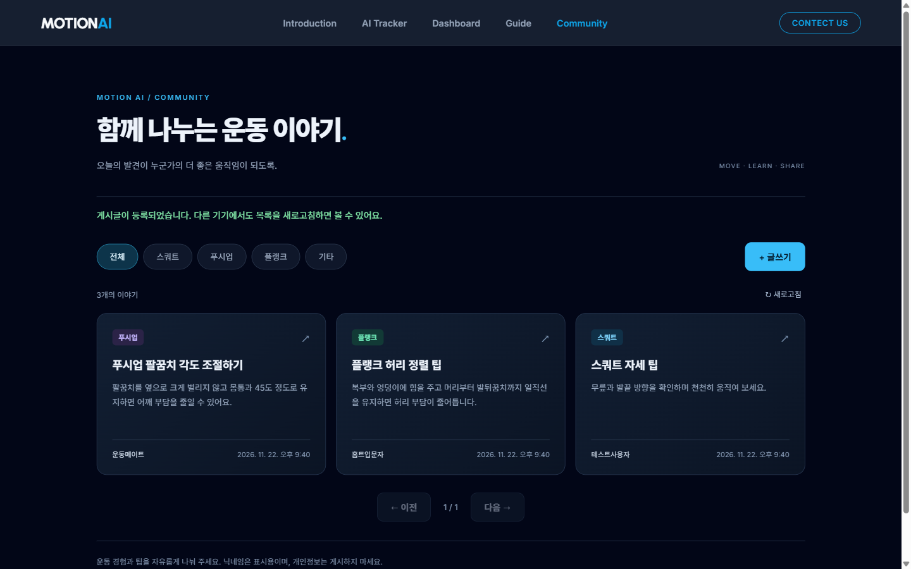

# MOTION AI 커뮤니티 사용자 가이드

MOTION AI의 커뮤니티에서는 운동 경험과 자세 교정 팁을 게시글로 공유할 수 있습니다. 이 문서는 처음 방문한 사용자를 위해 커뮤니티 접속, 글 작성, 글 조회, 운동 종류별 필터 사용 방법을 안내합니다.

> **검증 범위:** `docs/community-user-guide` 브랜치에서 `README.md`, `static/index.html`, `static/community.js`, `static/community-api.js`, `app.py`를 확인하고 로컬 서버(`http://127.0.0.1:8000/`)를 직접 실행해 브라우저로 검증했습니다. 다중 기기 LAN 접속과 2페이지 이상 페이지 이동 등 이번 환경에서 직접 시험하지 않은 항목은 아래 검증 기록에 미검증으로 구분해 두었습니다.

## 시작하기

1. 프로젝트의 [README 설치와 실행 안내](../README.md#-%EC%84%A4%EC%B9%98%EC%99%80-%EC%8B%A4%ED%96%89)를 따라 MOTION AI 서버를 실행합니다.
2. 브라우저 주소창에서 `http://127.0.0.1:8000/#community`로 접속합니다. 또는 메인 화면 상단의 **Community** 메뉴를 선택합니다.
3. **함께 나누는 운동 이야기.** 제목과 게시글 목록, `전체` / `스쿼트` / `푸시업` / `플랭크` / `기타` 필터를 확인합니다.

- **화면에서 확인할 결과:** 커뮤니티 목록이 보이며, 게시글이 없을 때는 `0개의 이야기`와 함께 **아직 등록된 이야기가 없어요.**라는 안내가 표시됩니다.

## 1. 게시글 작성하기

1. 커뮤니티 목록 화면 오른쪽의 **+ 글쓰기** 버튼을 누릅니다.
2. **닉네임**, **운동 종류**, **제목**, **내용**을 순서대로 입력합니다.
   - **운동 종류:** `스쿼트`, `푸시업`, `플랭크`, `기타` 중 하나
   - **입력 길이 제한:** 닉네임 최대 20자, 제목 최대 100자, 내용 최대 5,000자
3. **게시글 등록** 버튼을 누릅니다.
4. 등록 후 목록에서 작성한 글의 제목이 보이는지 확인합니다.

- **화면에서 확인할 결과:** 정상 등록 시 목록 화면으로 돌아가고, **게시글이 등록되었습니다. 다른 기기에서도 목록을 새로고침하면 볼 수 있어요.**라는 안내가 표시됩니다. 빈 칸이나 제한 길이를 초과한 입력은 필드별 오류 안내(예: `닉네임은(는) 1~20자로 입력해 주세요.`)가 나옵니다.
- **시험해 볼 예시:** 닉네임 `테스트사용자`, 운동 종류 `스쿼트`, 제목 `스쿼트 자세 팁`, 내용 `무릎과 발끝 방향을 확인하며 천천히 움직여 보세요.` (실명이나 연락처는 입력하지 마세요.)

## 2. 게시글 목록 및 상세 내용 조회하기

1. 커뮤니티 목록에서 게시글 카드를 클릭합니다.
2. 상세 화면에 운동 종류, 제목, 작성자 닉네임, 작성 시간, 본문이 표시되는지 확인합니다.
3. 브라우저를 새로고침한 뒤에도 같은 글의 상세 화면이 열리는지 확인합니다.
4. **← 목록으로** 버튼을 눌러 다시 목록으로 돌아갑니다.

- **화면에서 확인할 결과:** 게시글 상세 주소는 `#community/post/게시글번호` 형태이고, 목록은 최신 게시글부터 표시됩니다. 목록 아래 **← 이전**, **다음 →**으로 페이지를 이동할 수 있습니다(페이지가 하나면 이동 버튼은 비활성화됩니다).

## 3. 운동 종류별 게시글 필터 사용하기

1. 커뮤니티 목록 상단에서 **스쿼트** 필터를 선택합니다.
2. 현재 목록에 스쿼트 게시글만 표시되는지 확인합니다.
3. 다른 종류(예: **플랭크**)를 선택하여 목록이 바뀌는지 확인합니다.
4. **전체**를 누르면 다시 모든 종류의 게시글이 표시되는지 확인합니다.
5. 다른 기기에서 추가된 게시글을 확인하려면 **↻ 새로고침**을 누릅니다.

- **화면에서 확인할 결과:** 선택한 운동 종류만 표시되며, 해당 종류에 글이 없으면 빈 목록 안내가 나타납니다. 필터를 선택하면 목록 페이지가 1페이지로 바뀝니다.

## 주의 사항과 문제 해결

| 상황 | 확인 및 해결 방법 |
| :--- | :--- |
| 웹페이지가 열리지 않음 | `python main.py` 또는 Windows용 `start.cmd`로 서버가 실행 중인지 확인하고 `http://127.0.0.1:8000/#community`로 접속합니다. HTML 파일을 직접 더블클릭해 열지 않습니다. |
| 글 목록이 표시되지 않거나 저장에 실패함 | 서버가 종료되었는지 확인하고 **↻ 새로고침**이나 화면의 **다시 시도** 버튼을 사용합니다. 계속 실패한다면 서버 터미널의 오류를 확인합니다. |
| 게시글 등록이 안 됨 | 닉네임·운동 종류·제목·내용이 모두 입력되어 있는지, 길이 제한을 넘지 않았는지 확인합니다. |
| 다른 사람이 쓴 글이 바로 보이지 않음 | 목록은 자동으로 갱신되지 않으므로 **↻ 새로고침**을 누릅니다. 같은 서버에 접속했는지도 확인합니다. |
| 작성한 게시글을 수정·삭제하려고 함 | 현재 버전의 사용자 화면은 댓글·수정·삭제 기능을 제공하지 않습니다. 게시 전에 내용을 확인합니다. |

- **개인정보 주의:** 닉네임은 본인 확인 수단이 아니며, 게시글은 같은 서버에 접속한 다른 사용자에게 공개됩니다. 실명, 이메일, 전화번호, 학생번호 등 개인정보를 올리지 마세요.
- **게시글 저장 위치:** 기본 설정에서는 `instance/community.sqlite3`에 저장됩니다. 서버를 다시 실행해도 같은 DB 파일을 사용하는 한 게시글이 유지됩니다.

## 직접 실행 검증 기록

아래 항목은 로컬 서버(`python main.py`)와 브라우저를 직접 실행해 확인한 결과입니다.

| 검증 항목 | 실행 방법 | 실제 결과 | 판정 |
| :--- | :--- | :--- | :--- |
| 커뮤니티 접속 | `http://127.0.0.1:8000/`에서 **Community** 메뉴 선택 후 `/#community` 진입 | 제목(`함께 나누는 운동 이야기.`), 5개 필터, `0개의 이야기` 및 빈 목록 안내 정상 표시 | 정상(검증 완료) |
| 입력 검증 및 게시글 작성 | 빈 입력 제출 후 필드별 오류 확인, 이후 `스쿼트`·`플랭크`·`푸시업` 테스트 글 3건 등록 | 빈 입력 시 항목별 오류 안내 표시, 등록 시 목록 이동·완료 안내·`3개의 이야기` 표시 | 정상(검증 완료) |
| 게시글 상세 조회 및 새로고침 | `스쿼트 자세 팁` 카드 클릭(`/#community/post/1`) 후 브라우저 새로고침 및 `← 목록으로` 클릭 | 상세 내용 정상 표시, 새로고침 후 동일 글 유지, 목록 정상 복귀 | 정상(검증 완료) |
| 운동 종류 필터 및 새로고침 | `스쿼트`(1건) → `플랭크`(1건) → `기타`(0건 빈 안내) → `전체`(3건) → `↻ 새로고침` 순차 실행 | 각 필터별 목록 개수·내용 정상 전환 및 빈 필터 안내 확인 | 정상(검증 완료) |
| 서버 재실행 후 데이터 보존 | 실행 중인 `python main.py` 종료 후 재실행하여 `/#community` 재접속 | `instance/community.sqlite3`에 저장된 기존 3건의 게시글이 그대로 유지됨 | 정상(검증 완료) |
| 2페이지 이상 페이지 이동 | 13건 이상 등록 후 `다음 →`·`← 이전` 이동 | 3건만 테스트해 1페이지 비활성화 상태만 확인 | 미검증 |
| 다중 기기 LAN 공유 | 같은 Wi-Fi의 다른 기기에서 서버 IP로 동시 접속·조회 | 단일 PC `127.0.0.1` 환경에서만 테스트 | 미검증 |

- **검증 환경 기록:** 실행일 `2026-11-22` / 운영체제 `Windows 11 (Microsoft Windows NT 10.0.26200.0)` / Python `3.14.5` (`Flask 3.1.3`, `Waitress 3.0.2`) / 브라우저 `Playwright Chromium (1440×900)` / 기준 브랜치·커밋 `docs/community-user-guide (f86671f)`

## 실행 화면 캡처

실제 실행 화면에서 브라우저 영역만 캡처하여 개인정보가 없는 테스트 게시글 상태로 저장했습니다.

- 메인 화면: [docs/images/main-screen.png](images/main-screen.png)
- 커뮤니티 화면: [docs/images/community-screen.png](images/community-screen.png)

## 제공하지 않는 기능

현재 구현된 커뮤니티 화면은 댓글 작성, 게시글 수정·삭제, 로그인 및 좋아요 기능을 제공하지 않습니다. 이 문서는 실제 구현된 작성·조회·필터 기능에 한정합니다.
